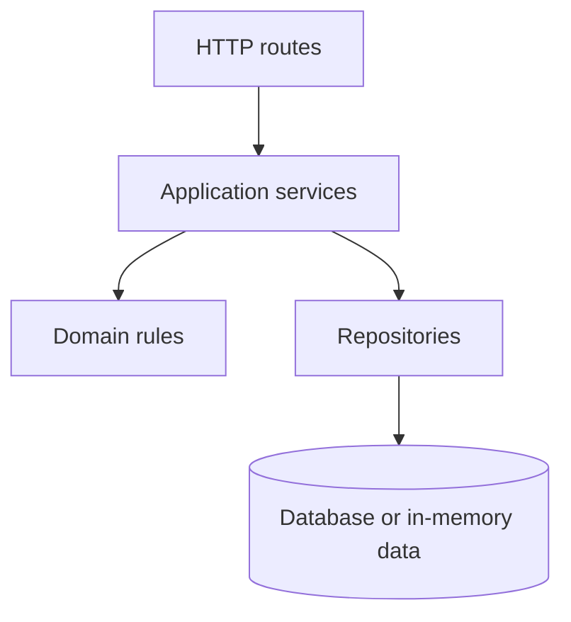
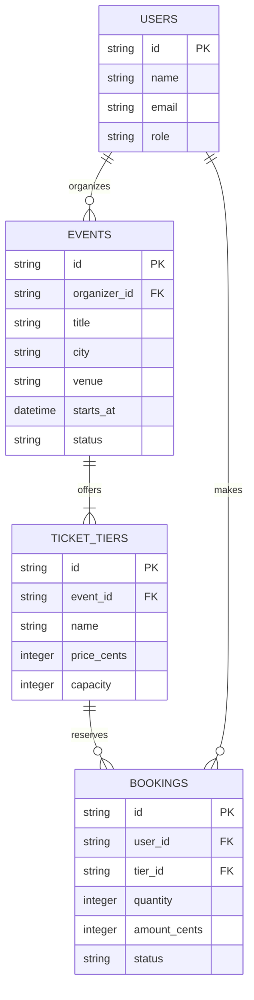
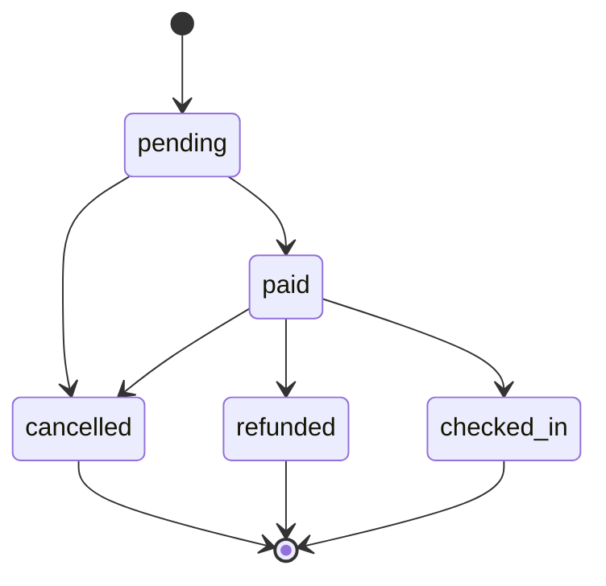

# Build 3 Architecture

## Layers

- Routes may translate HTTP requests and responses, but may not implement business rules or access data directly.
- Services may coordinate domain rules and repositories, but may not depend on HTTP details or call routes.
- Rules may enforce business invariants using supplied values, but may not perform HTTP, persistence, or other I/O.
- Repositories may load and save data, but may not decide business policy or call services, routes, or rules.

## Data Model

## Booking Life Cycle

